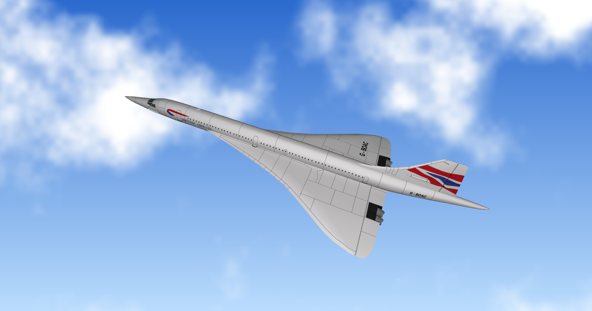

# Concorde Sonic Boom Simulation

A real-time, interactive audiovisual simulation of an aircraft breaking the sound barrier. The project models the *Concorde* during its transition from subsonic to supersonic flight, recreating both the **visual formation of the Mach cone** and the **sound heard by an observer**, including the Doppler effect and the sonic boom.

**The complete development process is documented in a pdf file found in documentation/english/milestones.**

Developed for *Projects IV: Graphics Programming, Immersive Systems and Video Games*.

## Overview

Instead of solving the full compressible Navier–Stokes equations, the simulation relies on simplified models that are cheap enough to run in real time:

- **Kinematics:** uniformly accelerated motion along an inclined climb path, starting at Mach 0.95 at 8,500 m.
- **Visual model:** Huygens' principle. The aircraft emits spherical wavefronts whose envelope forms the Mach cone, with $\sin\mu = 1/M$.
- **Acoustic model:** retarded-time solving and a dynamic Doppler shift for an accelerating source.
- **Synthesized audio:** no audio files are used. The turbine noise (filtered white noise with Doppler resampling) and the N-wave sonic boom (with crackle and reverb) are generated numerically.

## Features

- Real-time 3D rendering of the aircraft and its expanding wavefronts
- Two camera modes: attached to the aircraft or free-roaming
- Procedural, spatialized audio with distance attenuation
- Adjustable parameters (acceleration, climb angle, observer position)

## Tech Stack

| Purpose | Library |
|---|---|
| Numerics | NumPy, SciPy |
| Rendering | ModernGL (OpenGL / GLSL) |
| Real-time audio | sounddevice, soundfile |
| Analysis and validation | Matplotlib, Librosa, pytest |

## Project Structure

```
concorde_simulation/
├── main.py
├── requirements.txt
├── physics/          # trajectory, atmosphere, wavefronts
├── acoustics/        # retarded time, Doppler, sonic boom
├── dsp/              # noise, filters, resampling, audio engine
├── visualization/    # renderer, camera, shaders
├── analysis/         # spectral analysis, convergence, benchmarks
└── tests/
```

## Getting Started

```bash
pip install -r requirements.txt
python main.py
```

## Update Rates

The simulation runs three loops at different rates: physics at 120 Hz, rendering at 60 fps, and audio at 44,100 Hz in blocks of 256 samples.

## Status

Work in progress (November 2026 – February 2027). Subsystems are developed and validated independently before being integrated.

## Author

César Vidal Fernández


## Credits.

- Concorde Model: https://sketchfab.com/3d-models/concorde-6d95290363474798a429a38bbf9ad49d

## References.

- [NumPy Developers. 2024. "numpy.random.normal." *NumPy v2.1 Manual*](https://numpy.org/doc/2.1/reference/random/generated/numpy.random.normal.html).
- Richardson, Maguire. 2007. "Concorde - Take-off over the neighbourhood - Heathrow." Vídeo de YouTube, 1:01. [https://www.youtube.com/watch?v=i1ShTUVIzCI](https://www.youtube.com/watch?v=i1ShTUVIzCI).
- SciPy Developers. 2024. "scipy.signal.welch." En *SciPy Manual*. [https://docs.scipy.org/doc/scipy/reference/generated/scipy.signal.welch.html](https://docs.scipy.org/doc/scipy/reference/generated/scipy.signal.welch.html).